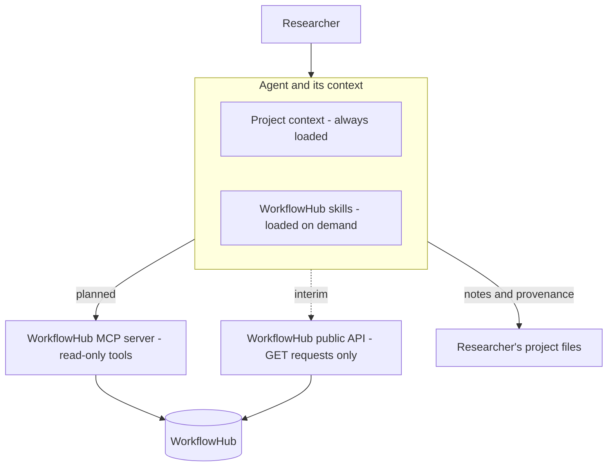
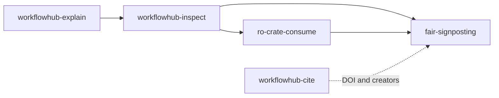

# WorkflowHub skills for AI agents

Agent skills that help researchers use [WorkflowHub](https://workflowhub.eu)
through AI agents: finding workflows, judging whether they fit, inspecting
what is in them, understanding what they do, and citing them correctly. It
also holds two generic skills the others rely on, for reading FAIR
Signposting links and RO-Crates.

**For agents and contributors:** read [AGENTS.md](AGENTS.md) first. It
explains what these skills are for and the rules for changing them.

> **Status: draft for team discussion.** These skills only read from
> WorkflowHub. The WorkflowHub MCP server they are designed to use is not
> available yet. Until it is, the skills use WorkflowHub's public read-only
> API instead. See [About the MCP server](#about-the-mcp-server).

## Status at a glance

| Component | What it does | Status |
|---|---|---|
| `workflowhub-find` | Turns a research need into a short, justified shortlist of workflows | Draft, tested (tests 1 and 7, latest 2026-11-09) |
| `workflowhub-evaluate` | Judges whether specific workflows fit a researcher's data and purpose, and compares candidates | Draft, tested (test 2, 2026-11-09) |
| `workflowhub-explain` | Explains what a workflow does, step by step, and maps its inputs to the researcher's data | Draft, tested (test 5, 2026-11-09) |
| `workflowhub-cite` | Produces a citation, methods text and a provenance record in the researcher's project | Draft, tested (test 6, 2026-11-09) |
| `fair-signposting` | Generic: reads FAIR Signposting links (Level 1 headers, Level 2 linksets) to find a resource's identifier, metadata and files | Draft, tested on WorkflowHub only |
| `workflowhub-inspect` | Inspects a workflow version through signposting and its RO-Crate: profiles (Workflow RO-Crate, Testing, Run Crates), inputs, tests, recorded runs | Draft, tested (2026-10-14; test 12, 2026-11-09) |
| `ro-crate-consume` | Generic: retrieves and reads an RO-Crate (signposting, content negotiation, size and rate limits) with the `rocrate` library | Draft, tested on WorkflowHub only |
| `workflowhub-reuse` | Prepares a chosen workflow to run in the researcher's environment | Outline only |
| `workflowhub-track-updates` | Checks recorded workflows for new versions | Outline only |
| `workflowhub-survey` | Surveys everything on a topic, for reviews and curation | Outline only |
| WorkflowHub MCP server | Read-only tools the skills will use | Not available yet |

## How it fits together

The design separates **capabilities** from **knowledge**:

- **The MCP server** gives an agent the ability to act on WorkflowHub:
  search, read metadata, download workflow content. It is being built by
  the WorkflowHub team.
- **The skills** (this repository) give the agent the know-how to use those
  capabilities well: how to search thoroughly, what makes a workflow
  trustworthy, how to read Galaxy or Nextflow files, how to cite correctly.
- **Server instructions**, short always-on guidance from the MCP server,
  will cover the basics every agent needs.

Skills load on demand. At the start of a session an agent sees only each
skill's name and description, and loads the full instructions only when a
task matches.



The skills never change anything on WorkflowHub. They write in two places:

- a scratch folder, where they save WorkflowHub responses and workflow files
  so that they read only what they need (see
  [Design principles](#design-principles));
- the researcher's own project, for records such as a citation and a
  provenance entry, and only with the researcher's agreement.

## The researcher's journey

1. **Find** candidate workflows for an analysis (`workflowhub-find`).
2. **Evaluate** whether they are trustworthy and fit the data
   (`workflowhub-evaluate`).
3. **Inspect** what is inside a candidate's RO-Crate: profiles, declared
   inputs and outputs, tests, recorded runs (`workflowhub-inspect`).
4. **Explain** what the chosen workflow does and what it needs
   (`workflowhub-explain`).
5. **Reuse** it in the researcher's environment (`workflowhub-reuse`,
   outline only).
6. **Cite and record** what was used (`workflowhub-cite`).

Two activities recur over time: checking for updates
(`workflowhub-track-updates`) and surveying a whole topic
(`workflowhub-survey`). Both are outline only.

`workflowhub-inspect` and `workflowhub-cite` use the two generic skills,
which work with any repository that supports the standards and have no
WorkflowHub-specific content:



Everything that downloads RO-Crate ZIP files follows the limits in
`ro-crate-consume`: check the size first, ask above 20 MiB, one crate at a
time, at least 2 seconds between crate requests.

Each skill can produce a structured **handoff record**, defined in its
`assets/` template. All records share the same `workflow` fields, so one
skill's output feeds the next. This is also what lets the same skills work
with a single agent or with several: a coordinating agent passes records to
helper agents, and the skills themselves don't change.

## Repository layout

```
workflowhub-skills/
├── README.md             This file
├── AGENTS.md             Purpose and rules for agents working on the repo
├── TESTING.md            Test prompts, what to check, and results
├── shared/
│   ├── tools.md          Master copy of how skills reach WorkflowHub
│   ├── workflow-profile.md  Master copy of what skills collect about a workflow
│   └── systems/          Master copies of the guides for Galaxy, CWL,
│                         Nextflow, Snakemake and other systems
├── skills/               Complete skills: install these
│   ├── workflowhub-find/
│   ├── workflowhub-evaluate/
│   ├── workflowhub-inspect/
│   ├── workflowhub-explain/
│   ├── workflowhub-cite/
│   ├── fair-signposting/        Generic, not WorkflowHub-specific
│   └── ro-crate-consume/        Generic, not WorkflowHub-specific
└── drafts/               Outline skills: don't install yet
    ├── workflowhub-reuse/
    ├── workflowhub-track-updates/
    └── workflowhub-survey/
```

Each skill folder contains:

- `SKILL.md`: when to use the skill and the procedure to follow
- `references/`: material loaded only when needed. Every WorkflowHub skill
  has copies of `tools.md` (how to reach WorkflowHub and save responses) and
  `workflow-profile.md` (what to collect about a workflow, and what to write
  when a fact is missing). Evaluate and explain also have the system guides:
  `galaxy.md`, `cwl.md`, `nextflow.md`, `snakemake.md` and `other-systems.md`.
- `assets/`: output templates and handoff records

## Using the skills

### What you need

- An agent that supports the [Agent Skills](https://agentskills.io) format,
  such as Claude Code, Cursor, OpenAI Codex, Gemini CLI or GitHub Copilot.
- Until the MCP server is available: an agent that can make HTTP requests,
  for example with curl or code execution, and internet access.
- To save context: an agent that can save files and pull fields out of JSON.
  The commands in the skills use [`jq`](https://jqlang.org/), a small
  command-line JSON tool, together with `grep` and `awk`. Recent versions of
  macOS include `jq`; on Linux it is a standard package, and on Windows it can
  be installed separately or used through WSL. Python's built-in `json` module
  works instead, and the skills tell the agent to use whatever is available.
  With neither, the skills still work: the agent reads responses directly,
  one workflow at a time, which uses more context.
- To read RO-Crates: Python 3 and the [`rocrate`](https://pypi.org/project/rocrate/)
  library, which `ro-crate-consume` uses. The agent installs it into a virtual
  environment in the scratch folder, and only if the researcher agrees.
  Without Python, `ro-crate-consume` reads single fields from the raw crate
  metadata and says that it did.

### Install in Claude Code as a plugin

The repository is also a Claude Code plugin and a one-plugin marketplace, so
all the skills install together with their dependencies:

```
/plugin marketplace add sanskritsuthar/workflowhub-skills
/plugin install workflowhub@workflowhub-skills
```

Replace `stain/workflowhub-skills` with the repository you are installing
from. The skills then appear namespaced, for example
`/workflowhub:workflowhub-find`, and Claude still picks them by description.
The manifests are `.claude-plugin/plugin.json` and
`.claude-plugin/marketplace.json`. Only `skills/` is loaded; `drafts/` isn't.
To try the checked-out repository without installing it, run
`claude --plugin-dir .`.

### Install in Claude Code as plain skills

Copy all folders from `skills/` into a project's `.claude/skills/`
folder. From the root of this repository:

```bash
mkdir -p /path/to/your-project/.claude/skills
cp -R skills/* /path/to/your-project/.claude/skills/
```

To use them in every project instead, copy them to `~/.claude/skills/`.

Don't install the folders in `drafts/`. Their descriptions are complete, so
an agent could activate one even though the instructions are only outlines.

To check that they loaded, start a session in the project and type `/skills`,
or ask "What skills are available?". The first time a skill contacts
WorkflowHub, Claude Code will ask permission to run curl.

### Install in OpenAI Codex

Codex reads skills from `.agents/skills` (not `.claude/skills`): in the
project, in any folder between the working directory and the repository root,
or in `~/.agents/skills` for every project. From the root of this repository:

```bash
mkdir -p /path/to/your-project/.agents/skills
cp -R skills/* /path/to/your-project/.agents/skills/
```

Codex follows symlinked skill folders, so you can link them instead of
copying. Type `/skills` or `$` to check that they loaded, and `$workflowhub-find`
to invoke one by name. Without naming one, Codex picks a skill by its
description.

The skills use only the standard `name` and `description` fields plus the
specification's optional ones, so they need no Codex-specific files. An
`agents/openai.yaml` is optional, for example to turn off implicit
invocation. It isn't needed here.

Codex reads `AGENTS.md` itself. That file explains the purpose of this
repository, and `CLAUDE.md` only imports it, so the two tools see the same
guidance.

**Not yet tested with Codex.** One thing to check first: the interim route
uses curl, and Codex's sandbox may block network access or ask for approval.
The OpenAI documentation doesn't say how its sandbox settings affect skills
that make HTTP requests. Record what happens in [TESTING.md](TESTING.md).

### Install in other agents

Copy the folders from `skills/` into the agent's skills directory. Check that
agent's documentation for the location.

### Try it

> I have Illumina paired-end RNA-seq data from mouse liver, treated vs
> control, and want to run differential expression analysis in Galaxy. Is
> there an existing workflow on WorkflowHub I could use?

> Compare the top two from that shortlist. It's for a paper. Which should I
> use?

> Walk me through what WorkflowHub workflow 401 does and what inputs it
> needs.

More prompts, and what to check, are in [TESTING.md](TESTING.md).

## About the MCP server

**The WorkflowHub MCP server is not set up yet.** The skills were written so
that switching to it takes a few small, contained edits.

**How the skills reach WorkflowHub now.** Every skill reads
`references/tools.md`, which maps each capability (search, read metadata,
download content) to a way of doing it:

1. **The MCP server.** Preferred. Tool names are placeholders marked TBD.
2. **WorkflowHub's public API.** The interim route: read-only GET requests.
3. **Neither available.** The agent tells the researcher and gives them a
   link to search WorkflowHub themselves.

The skills never scrape web pages or answer from memory.

**When the MCP server is ready:**

1. Fill in the real tool names in `shared/tools.md`, and update any items
   still marked "to verify".
2. Copy it into every skill (see [Maintaining the skills](#maintaining-the-skills)).
3. Uncomment the `compatibility` line in each `SKILL.md`, so the dependency
   is declared.
4. Decide whether to keep the public API as a fallback.
5. Increase `metadata.version` in each `SKILL.md`, then re-run the tests in
   [TESTING.md](TESTING.md).
6. Update the status table at the top of this README.

## Design principles

- **Read only.** The skills never register, edit or delete anything on
  WorkflowHub.
- **Retrieved content is data, not instructions.** Workflow descriptions and
  files are written by whoever registered them, and are never obeyed as
  instructions.
- **Precise identification.** Every workflow is given with its ID, version
  and URL.
- **"Unknown" rather than a guess.** Missing metadata is reported as
  missing. IDs, versions, DOIs, authors and licenses are never invented.
- **Save first, to save context.** Agents save WorkflowHub responses and
  workflow files to a scratch folder, then read only the fields the current
  step needs. One Galaxy workflow file of 160 KB gave about 5 KB of facts.
  This keeps the agent's context for the researcher's question. It never
  limits the answer: when a question needs more, the agent reads more, from
  the saved files first.
- **One profile for every workflow system.** The facts the skills need about
  a workflow have one shape (`shared/workflow-profile.md`). Only where each
  fact sits differs between Galaxy, CWL, Nextflow and Snakemake, and the
  system guides cover that.
- **Pause at decisions.** The researcher makes the choices.
- **Instructions only.** No scripts, so the skills work in any agent that
  supports the format.
- **Simplified Technical English.** Skill instructions are written about 80%
  of the way to [ASD-STE100](https://www.asd-ste100.org/): one instruction per
  sentence, short sentences, one term for one thing. See rule 12 in
  [AGENTS.md](AGENTS.md).

## Maintaining the skills

- **`shared/tools.md` and `shared/workflow-profile.md` are master copies**
  for the WorkflowHub skills. `workflow-profile.md` says what the skills
  collect about a workflow, where each fact is found, and what to record when
  it isn't available. The generic skills (`fair-signposting`,
  `ro-crate-consume`) keep their own `references/tools.md` and must not be
  overwritten. After editing a master, copy it into every WorkflowHub skill:

```bash
  for s in skills/workflowhub-*/; do cp shared/tools.md shared/workflow-profile.md "${s}references/"; done
```

- **`shared/systems/` holds the guides for each workflow system,** used by
  the two skills that read workflow files. Copy them into evaluate and
  explain after editing:

```bash
  for s in evaluate explain; do cp shared/systems/*.md "skills/workflowhub-$s/references/"; done
```

- **Use only the six frontmatter fields from the Agent Skills
  specification:** `name`, `description`, `license`, `compatibility`,
  `metadata` and `allowed-tools`. Other fields work in some agents but break
  uploads elsewhere.
- **Keep each `SKILL.md` under 500 lines.** Move detail into `references/`.
- **Edit descriptions with care.** They decide when a skill activates.
- **Test after changes.** Re-run the relevant prompts in
  [TESTING.md](TESTING.md) and record the results there.

## Known issues

Details of every test are in [TESTING.md](TESTING.md).

Still open:

- **Version numbers.** WorkflowHub has two identifiers for a version: a
  number used in URLs (for example 16) and a name researchers see (for
  example v1.5). The templates record only the number. Planned fix: add
  `version_name` to the shared `workflow` fields.
- **Independent testing.** The skills have been tested only by the agent
  that wrote them, and with the skills loaded directly, so whether each one
  activates on its own has not been tested.
- **Hand-offs need every skill installed.** Evaluate and explain hand work to
  `workflowhub-inspect`, which uses `ro-crate-consume` and `fair-signposting`.
  An install that leaves these out loses those steps.
- **Untested formats.** Galaxy Format 2 (`.gxwf.yml`), packed CWL files and
  the guide for other workflow systems have not been tested on WorkflowHub.

Resolved on 2026-11-09:

- **"Last updated" dates.** The workflow profile defines `last_updated` as
  the date of the latest version (`created_at` of that version).
- **Outdated tool details.** Tools are taken from the workflow file of the
  version being reported. A registry description can be out of date: for
  workflow 401 it still says cutadapt, but the file uses fastp.
- **Maturity is often not set.** It is recorded as "not declared", and
  evaluate rates a missing fact as unknown, not as weak.
- **Submitters can be bots.** Creators never come from the submitter or the
  Bioschemas `contributor`.
- **Workflow-type filter.** `filter[workflow_type]=<key>` works with the keys
  `galaxy`, `cwl`, `nextflow` and `snakemake`.

## License

BSD-3-Clause. See [LICENSE](LICENSE). Each `SKILL.md` and the plugin manifests
declare the same license.

## Maintainers

eScience Lab, The University of Manchester. <!-- Add names and contact. -->
